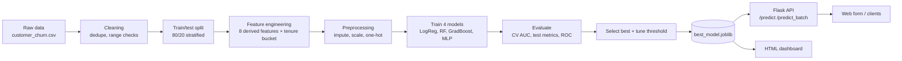

# AI Pipeline Architecture

## Components
| Layer | File | Role |
|---|---|---|
| Data | `src/generate_data.py` | Builds a 50k-row dataset with missing values and duplicates |
| Features | `src/features.py` | `clean`, `add_features`, `build_preprocessor` (one pipeline reused at serving time) |
| Training | `src/train.py` | Cross-validation, metrics, charts, threshold selection, model saving |
| Serving | `app/app.py` | Flask REST API and web form, loads the saved pipeline |
| Reporting | `src/dashboard.py` | Builds `outputs/dashboard.html` |
| Tests | `tests/test_api.py` | Health, prediction ordering and validation errors |

## Design decisions
- Feature engineering sits inside the sklearn Pipeline, so training and the API apply identical transforms and there is no leakage.
- The decision threshold is tuned for F1 because churn is imbalanced (about 33% positives).
- Deep learning here is a multilayer perceptron (scikit-learn `MLPClassifier`, 64-32 hidden units, early stopping).
